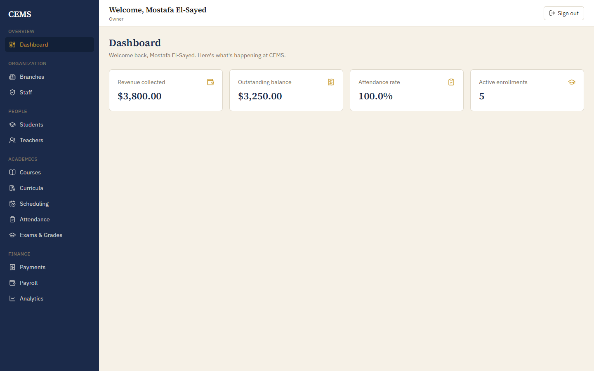
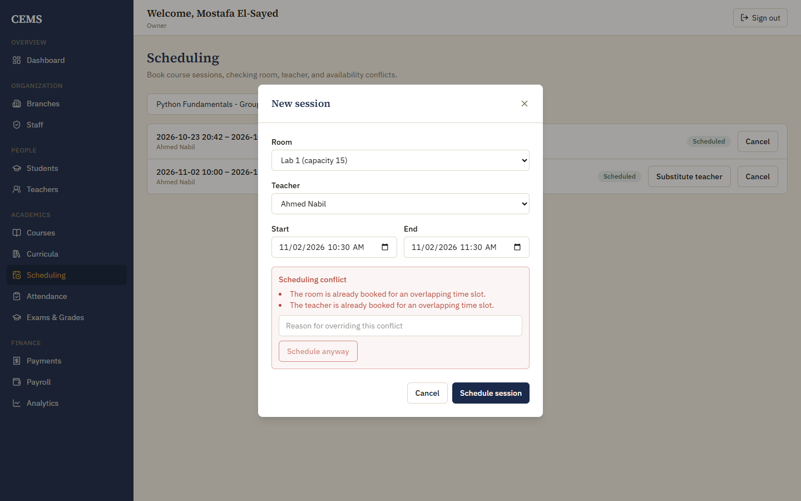
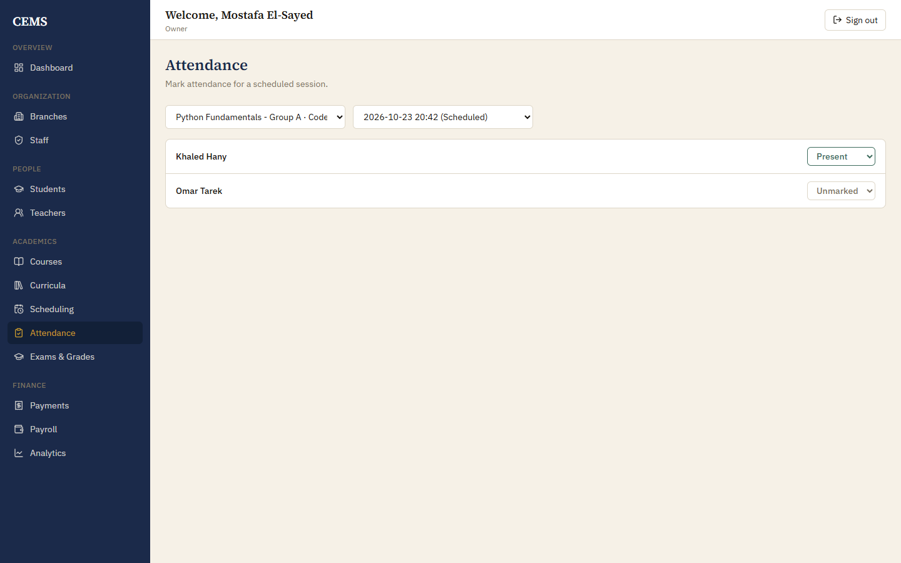
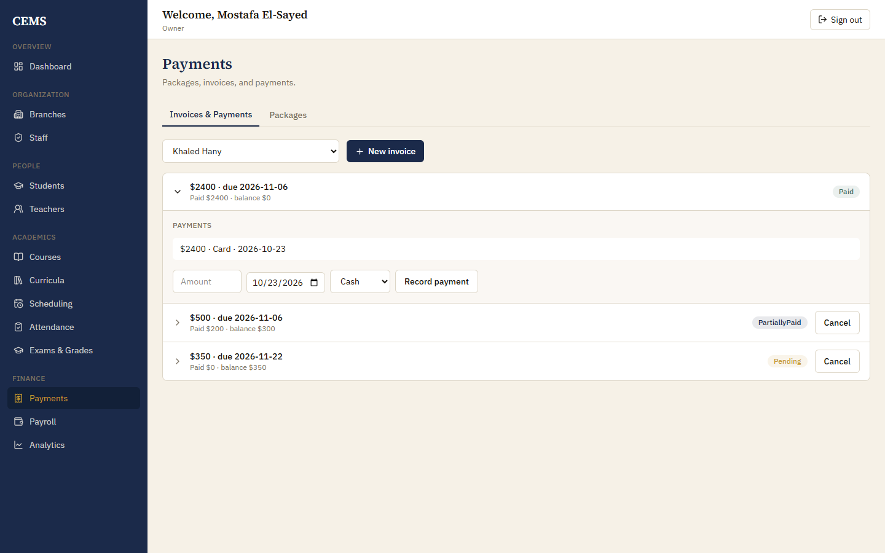
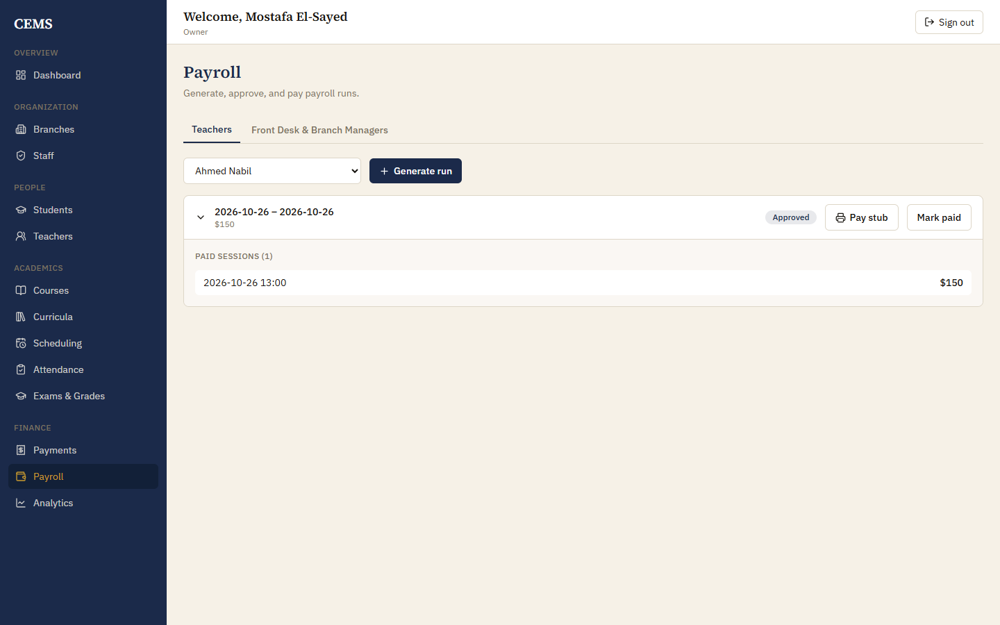
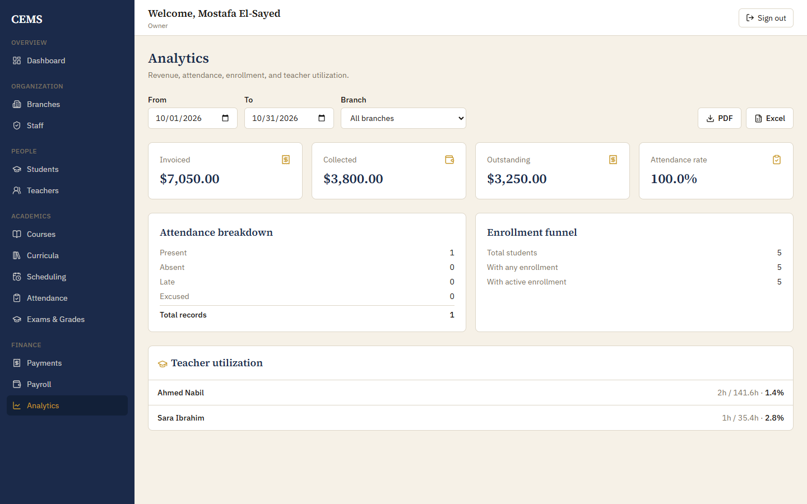
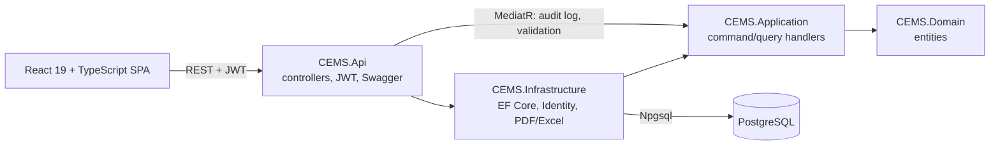

# CEMS

    [](https://github.com/alieldeenahmed/CEMS/actions/workflows/ci.yml)

A management system for a multi-branch educational center (ASP.NET Core 9, PostgreSQL, React) in which branch isolation and double-booking prevention are enforced server-side and in the database, and tested under real concurrency.

## What it does

Branches and rooms, teachers (shared across branches, with availability and course qualifications), students and guardians, courses tied to curricula, scheduled sessions with conflict detection, attendance, exams and grades, invoices and payments, and payroll computed under four different pay models (hourly, per session, fixed, percentage of revenue). Reports export as PDF and Excel. Four roles see different slices of the same data (see [Roles](#roles)).

## Engineering highlights

- **Branch-scoped authorization that is re-checked on every request.** Handlers that load branch-owned records call `EnsureAccessToBranch` ([`CurrentUserExtensions.cs`](Backend/src/CEMS.Application/Common/Interfaces/CurrentUserExtensions.cs)); 71 of the 114 handlers reference a scope check, and the rest are Owner-only, own-data or identity operations behind a role check. On every request [`CurrentAccountValidator.cs`](Backend/src/CEMS.Api/Auth/CurrentAccountValidator.cs) re-reads the account from the database and replaces the token's role and branch claims, so deactivating an account or moving it to another branch takes effect immediately instead of when the JWT expires. Evidence: an endpoint-by-endpoint role snapshot ([`authorization-surface.txt`](Backend/tests/CEMS.Api.Tests/authorization-surface.txt)), a sweep that calls every id-taking route as someone who must not reach it ([`AccessSweepTests.cs`](Backend/tests/CEMS.Api.Tests/AccessSweepTests.cs)), and [`AccountLifecycleTests.cs`](Backend/tests/CEMS.Api.Tests/AccountLifecycleTests.cs).
- **Double-booking is prevented under concurrency.** Booking a session takes PostgreSQL advisory locks on the room and teacher, in a deterministic (sorted) order so competing requests cannot deadlock ([`Locking.cs`](Backend/src/CEMS.Application/Common/Concurrency/Locking.cs), [`ApplicationDbContext.cs`](Backend/src/CEMS.Infrastructure/Persistence/ApplicationDbContext.cs)). Behind the locks, `EXCLUDE USING gist` constraints make the database itself refuse two overlapping ordinary sessions in a room or for a teacher ([migration](Backend/src/CEMS.Infrastructure/Persistence/Migrations/20260919225516_AddSchedulingOverlapConstraints.cs)). Sessions a manager knowingly overrides, with a recorded reason, are deliberately exempt. Details in [docs/ARCHITECTURE.md](docs/ARCHITECTURE.md#concurrency-and-conflict-prevention).
- **Other rules live in the database too.** A partial unique index allows only one live (active or waitlisted) enrollment per student per course while letting a dropped one coexist ([`CourseEnrollmentConfiguration.cs`](Backend/src/CEMS.Infrastructure/Persistence/Configurations/CourseEnrollmentConfiguration.cs)); exclusion constraints stop overlapping payroll periods; check constraints reject non-positive amounts and inverted periods.
- **Tested against a real PostgreSQL, including races.** 527 backend tests: 326 handler tests and 157 HTTP tests on SQLite in-memory, and 44 on a real PostgreSQL server ([`CEMS.Postgres.Tests`](Backend/tests/CEMS.Postgres.Tests)). 18 of those release N requests at the same instant (for example eight bookings of one room and slot must produce exactly one success). To check the tests can fail, the protections were disabled in turn: with the advisory locks off 1 of the 10 scheduling-race tests failed, and with the locks and exclusion constraints both off 5 failed. They fail rather than skip when no PostgreSQL is reachable.
- **Money and payroll are exact.** Amounts are `numeric(10,2)`; validators reject a third decimal place up front, a payment cannot exceed the invoice balance, invoice status is recomputed from the sum of payments on every write, and each payroll line is rounded to the cent so a run's total equals the sum of its lines.
- **Audit logging that cannot leak secrets.** One log line per successful command: who, which command, and the values of its `Guid` properties only, so passwords, emails and amounts never reach a log ([`AuditLoggingBehavior.cs`](Backend/src/CEMS.Application/Common/Behaviors/AuditLoggingBehavior.cs), checked by [`AuditLoggingApiTests.cs`](Backend/tests/CEMS.Api.Tests/AuditLoggingApiTests.cs)).
- **Structure.** Clean Architecture (`Domain → Application → Infrastructure → Api`), CQRS with MediatR: 114 handlers behind 114 endpoints, each command validated by FluentValidation.
- **CI** ([`ci.yml`](.github/workflows/ci.yml)) builds and tests the backend against a PostgreSQL service container, lints/tests/builds the frontend, and runs a Docker Compose smoke test: builds the API image, seeds it, signs in, reads data, fetches the Swagger document and a QuestPDF export.

## Screenshots

Signed in as the Owner on the seeded demo data.

<table>
<tr>
<td width="50%"><br/><sub>Dashboard: revenue, outstanding balance, attendance rate, active enrollments</sub></td>
<td width="50%"><br/><sub>Booking over an existing session: both conflicts are listed, and a manager can override with a reason</sub></td>
</tr>
<tr>
<td width="50%"><br/><sub>Attendance roster for a finished session</sub></td>
<td width="50%"><br/><sub>One student's invoices: paid, partially paid and pending, with payment history</sub></td>
</tr>
<tr>
<td width="50%"><br/><sub>An approved payroll run for an hourly teacher, with its per-session breakdown</sub></td>
<td width="50%"><br/><sub>Analytics: revenue, attendance, enrollment funnel, teacher utilization</sub></td>
</tr>
</table>

## Architecture



Every request: JWT validation, then the account is re-read from the database, then the controller's role check, then the MediatR pipeline, then the handler's branch check. The full request flow, concurrency design, schema diagram, and the CORS and UTC-time rationale are in [docs/ARCHITECTURE.md](docs/ARCHITECTURE.md).

### Roles

| Role | Scope | Can do |
|---|---|---|
| **Owner** | All branches | Everything, including branches, teacher records and pay, payroll approval, activating/deactivating staff |
| **BranchManager** | Own branch(es) | Courses, rooms, packages, scheduling (including conflict overrides), teacher qualifications and availability, cancelling invoices, analytics for the branch, staff accounts for the branch (not other managers), password resets |
| **FrontDesk** | Own branch(es) | Students, guardians, enrollment, invoices and payments, scheduling without overrides; is not sent teacher pay |
| **Teacher** | What they teach | Own schedule and availability, attendance for their sessions, exams and grades for their courses, students they teach, own payroll runs |

The exact endpoint-by-role list is [`authorization-surface.txt`](Backend/tests/CEMS.Api.Tests/authorization-surface.txt).

## Tech stack

| | |
|---|---|
| Backend | ASP.NET Core 9, MediatR, FluentValidation, Entity Framework Core 9 (Npgsql), ASP.NET Identity + JWT bearer, QuestPDF, ClosedXML, Swashbuckle (Swagger, Development only) |
| Database | PostgreSQL (16 in Docker Compose and CI) |
| Frontend | React 19, TypeScript, Vite, Tailwind CSS 4, TanStack Query, React Hook Form + Zod, React Router, axios |
| Tests | xUnit (SQLite in-memory and PostgreSQL), Vitest + React Testing Library |
| Tooling | GitHub Actions, Docker Compose, oxlint |

## Getting started

### With Docker (recommended)

Needs Docker, bash and curl for the seed script, and Node.js (CI uses 22) for the frontend.

```bash
git clone https://github.com/alieldeenahmed/CEMS.git && cd CEMS
docker compose --profile app up -d --build   # PostgreSQL 16 + the API; migrations are applied on start
./scripts/seed-demo-data.sh                  # demo data (see below)
cd Frontend && npm ci && npm run dev         # http://localhost:5173
```

The API is at `http://localhost:5272` and Swagger UI at [`/swagger`](http://localhost:5272/swagger) (the Compose API runs in the Development environment). Compose defaults are development-only and documented in [`.env.example`](.env.example); copy it to `.env` to change them. `docker compose down -v` also removes the database volume. On Windows without bash, seed with `./scripts/seed-demo-data.ps1` instead.

### Without Docker

Needs the .NET 9 SDK, Node.js, and a PostgreSQL you can connect to. Set the connection string and a JWT key (any random string of 32+ bytes), and ask the API to create the schema on first start:

```bash
# bash / zsh
export ConnectionStrings__Default="Host=localhost;Port=5432;Database=cems;Username=postgres;Password=YOUR_PASSWORD"
export Jwt__Key="$(openssl rand -base64 48)"
export Database__MigrateOnStartup=true
dotnet run --project Backend/src/CEMS.Api     # http://localhost:5272, Swagger at /swagger
```

```powershell
# PowerShell
$env:ConnectionStrings__Default = "Host=localhost;Port=5432;Database=cems;Username=postgres;Password=YOUR_PASSWORD"
$env:Jwt__Key = -join ((48..57) + (65..90) + (97..122) | Get-Random -Count 48 | ForEach-Object { [char]$_ })
$env:Database__MigrateOnStartup = "true"
dotnet run --project Backend/src/CEMS.Api
```

Then seed and start the frontend as above (`./scripts/seed-demo-data.sh`, or `./scripts/seed-demo-data.ps1` on Windows). `Database__MigrateOnStartup` is off by default; to migrate explicitly instead, use `dotnet ef database update --project Backend/src/CEMS.Infrastructure --startup-project Backend/src/CEMS.Api` with `ConnectionStrings__Default` set (`dotnet ef` reads only that environment variable, not user-secrets). Problems? See [docs/TROUBLESHOOTING.md](docs/TROUBLESHOOTING.md).

### Demo data

[`scripts/seed-demo-data.sh`](scripts/seed-demo-data.sh) (bash and curl; the PowerShell twin is [`seed-demo-data.ps1`](scripts/seed-demo-data.ps1)) populates an empty database by calling the real API, so every row passes through password hashing, authorization, conflict checks and payroll computation. It models a two-branch coding school in Alexandria. It is not idempotent: run it once on an empty database. All demo passwords are `DemoPass123`; accounts include `owner@codecamp.demo`, `bm.smouha@codecamp.demo`, `fd.smouha@codecamp.demo` and `teacher.smouha@codecamp.demo`.

There is no sign-up endpoint. The first account comes from `POST /api/auth/bootstrap-owner`, which is anonymous but refuses to work once any user exists (and is serialized so two simultaneous first requests cannot create two Owners). Every other account is created by an authenticated staff member via `POST /api/users/staff`. The seed script uses bootstrap-owner for the Owner and the staff endpoint for the rest.

## Testing

```bash
dotnet test Backend/CEMS.sln                                                      # all three backend projects
dotnet test Backend/CEMS.sln --filter "FullyQualifiedName!~CEMS.Postgres.Tests"   # fast suites only, no PostgreSQL needed
cd Frontend && npm run test:coverage                                              # 264 tests, fails below a 90% coverage floor
```

- `CEMS.Application.Tests` (326): handlers against a real EF Core context on SQLite in-memory, plus the real MediatR pipeline and Identity/JWT code.
- `CEMS.Api.Tests` (157): the whole HTTP stack through `WebApplicationFactory`: routing, JWT, error mapping, multi-step workflows, the authorization snapshot and the access sweep, log assertions.
- `CEMS.Postgres.Tests` (44): what SQLite cannot show. Every migration applied to an empty database, the exclusion/unique/check constraints, `timestamptz` and `numeric` behavior, the migrate-on-startup flag, and the simultaneous-request race tests.

`CEMS.Postgres.Tests` needs a server whose role may `CREATE DATABASE`; it creates and drops a throwaway database per test class. Point `CEMS_TEST_POSTGRES` at one, for example the Compose database:

```bash
docker compose up -d
export CEMS_TEST_POSTGRES="Host=localhost;Username=cems;Password=cems_dev_password"
```

The full PostgreSQL suite takes about a minute because the race tests use real concurrency. Backend line coverage measured locally is about 98% (all three projects merged, migrations excluded) and frontend line coverage about 99%.

## Design decisions and limitations

This is a portfolio project and a local demo system, not a production service. There is no hosted instance, and the Docker Compose file uses development credentials.

- **Branch isolation is a convention backed by tests**, not a global query filter: each handler calls the check itself. A convention can be forgotten, which is why the snapshot and access-sweep tests exist. Owner-only payroll handlers rely on the controller's role check.
- **All times are UTC**, with no per-branch timezone. Teacher availability is a weekly day-and-time window, so a session that crosses midnight is treated as outside availability.
- **JWTs last 6 hours with no refresh token**, and the per-request account check adds a few database reads to each authenticated call. There is no "sign out everywhere". Five wrong passwords lock an account for 15 minutes (which also lets someone who knows an address lock it out).
- **Teacher qualification is a hard rule.** A teacher who is not qualified for a course cannot be booked or substituted in, and no override waives it.
- **Percentage-based teacher payroll** pays each teacher of a course their percentage of that course's full collected revenue (co-teachers each get a share of the same money), and still counts payments on invoices later cancelled while partly paid.
- **A payment cannot exceed the invoice's remaining balance** (there is no customer-credit model) and cannot be future-dated.
- **A front-desk user can delete a student**, but only one with no enrollments, attendance, grades or invoices; anyone with history must be set to Paused or Graduated.
- **Guardians are contact records with no login**, by design; there is no parent portal.
- **No email**: password resets are admin-assisted; there are no invoice reminders.
- **Logging goes to the console only**; no log sink, metrics or tracing backend is configured.
- **Swagger is served only in the Development environment.**

## Roadmap

Ideas, not commitments, taken from the limitations above: per-branch timezones and sessions that cross midnight; refresh tokens and session revocation; email for password resets and invoice reminders; a structured log sink and metrics; re-checking the role inside the Owner-only payroll handlers as well as at the controller. A module-by-module status table is in [docs/PROGRESS.md](docs/PROGRESS.md).

## License

Licensed under the [MIT License](LICENSE).
