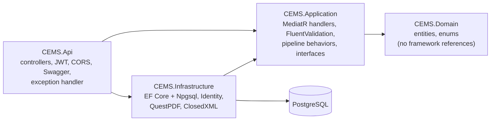
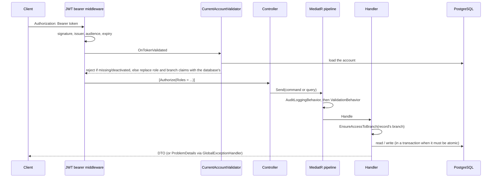
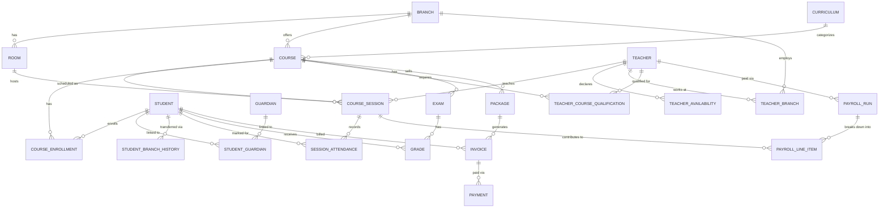

# Architecture

This document explains how CEMS is put together and why. Every statement is checked against the code; file paths are given so you can check it too.

## Layers



- `Backend/src/CEMS.Domain` has no framework references. ASP.NET Identity's `ApplicationUser` lives in `CEMS.Infrastructure`, so a domain entity that refers to a user stores a plain `Guid`.
- `Backend/src/CEMS.Application` depends on `Domain` and defines the abstractions it needs (`IApplicationDbContext`, `ICurrentUserService`, `IIdentityService`, `IJwtTokenGenerator`). `Infrastructure` implements them. Handlers use EF Core's `DbSet`s directly through `IApplicationDbContext`; there is no repository layer on top of EF.
- `Backend/src/CEMS.Api` is the composition root: it wires the layers together and owns HTTP concerns only.

There are 114 handlers (`*CommandHandler` / `*QueryHandler`), 16 controllers and 114 endpoints.

## Request flow



Evidence: `Backend/src/CEMS.Api/Program.cs` (JWT events, `OnTokenValidated = CurrentAccountValidator.ValidateAsync`), `Backend/src/CEMS.Api/Auth/CurrentAccountValidator.cs`, `Backend/src/CEMS.Application/DependencyInjection.cs` (behaviors registered in that order), `Backend/src/CEMS.Api/Middleware/GlobalExceptionHandler.cs`.

### Authorization in two layers

1. **Role**, at the controller: `[Authorize(Roles = ...)]`. The full list of who may call what is pinned by a snapshot test, `Backend/tests/CEMS.Api.Tests/authorization-surface.txt` (114 lines, one per endpoint).
2. **Branch**, in the handler that loads a branch-owned record: `ICurrentUserService.EnsureAccessToBranch(branchId)` (defined in `CEMS.Application/Common/Interfaces/CurrentUserExtensions.cs`). 71 of the 114 handlers reference a branch-scope check (`EnsureAccessToBranch`, `HasAccessToBranch`, `VisibleTo` for guardians, or `AnalyticsAccess`). The rest are Owner-only operations, "my own data" queries, or identity operations that rely on the controller's role check and the caller's own id.

Because the roles and branches in the token are replaced on every request by the account's current ones, a deactivated account or a changed assignment takes effect immediately instead of when the token expires.

A convention can be forgotten, so it is also tested from outside: `Backend/tests/CEMS.Api.Tests/AccessSweepTests.cs` calls every id-taking route as someone who must not reach the resource and requires 403 or 404.

## Concurrency and conflict prevention

Booking a session is a check-then-write sequence: "is the room free? then insert". Two simultaneous requests can both pass the check. CEMS closes that in two layers.

**Layer 1: advisory locks, taken in a deterministic order.** `BeginLockedTransactionAsync` (`CEMS.Application/Common/Concurrency/Locking.cs`) opens a transaction and calls `AcquireLocksAsync`, which runs `pg_advisory_xact_lock(hashtextextended(key, 0))` for each key, **after sorting the keys with ordinal comparison** (`Backend/src/CEMS.Infrastructure/Persistence/ApplicationDbContext.cs`). Two requests that need overlapping sets of locks therefore always acquire them in the same order and cannot deadlock. The second request waits, then runs its checks and sees the first request's committed session. Lock keys are defined once in `LockKeys` (room, teacher, per-course enrollments, per-invoice, per-teacher payroll, and so on). `AcquireLocksAsync` throws if called outside a transaction, because a transaction-scoped advisory lock taken in autocommit would be released immediately and protect nothing.

**Layer 2: database constraints as the backstop.** The migration `AddSchedulingOverlapConstraints` creates two exclusion constraints on `CourseSessions`:

```sql
EXCLUDE USING gist ("RoomId"   WITH =, tstzrange("StartUtc", "EndUtc") WITH &&) WHERE (NOT "Overridden" AND "Status" <> 2);
EXCLUDE USING gist ("TeacherId" WITH =, tstzrange("StartUtc", "EndUtc") WITH &&) WHERE (NOT "Overridden" AND "Status" <> 2);
```

Even a code path that forgot to take the lock cannot store two ordinary, non-cancelled sessions that overlap in the same room or for the same teacher. Ranges are half-open, so back-to-back sessions are fine. Sessions a manager has knowingly overridden are exempt (that is what an override is) and carry their reason on the row. `ApplicationDbContext.SaveChangesAsync` translates a violation into the same `SchedulingConflictException` the handlers throw, which the API maps to `409 Conflict`.

Other database-enforced rules (`AddEnrollmentIndexesAndCheckConstraints`):

- Partial unique index `ux_course_enrollments_live_per_student_course` (`WHERE "Status" <> 1`, i.e. not Dropped): one live (active or waitlisted) enrollment per student per course, while a dropped one may coexist so a student can re-enroll.
- Partial unique index `ux_course_enrollments_waitlist_position`: unique waitlist positions per course.
- Exclusion constraints on `PayrollRuns` and `StaffPayrollRuns`: no overlapping payroll periods for the same teacher or staff member.
- Check constraints: positive amounts, ordered periods, session end after start.

**Where the locks are used:** session create and teacher substitution, enrollment and waitlist promotion (per course), recording and cancelling a payment (per invoice), payroll generation and approval, student branch transfers, and the one-time Owner bootstrap.

**Proof.** `Backend/tests/CEMS.Postgres.Tests` runs against a real PostgreSQL server. Its `RaceAsync` helper releases N requests at the same instant, each with its own `DbContext`/connection. 18 of the 42 tests do this, for example eight requests for the same room and slot must yield exactly one success and seven `SchedulingConflictException`s. To check that those tests can actually fail, the protections were removed in turn: with the advisory locks disabled (constraints still active) 1 of the 10 scheduling-race tests failed, and with the locks and the exclusion constraints both disabled 5 of 10 failed.

## Time handling

All times are UTC. `ApplicationDbContext.OnModelCreating` installs a `ValueConverter` on every `DateTime` property that normalises values to `DateTimeKind.Utc`: Npgsql rejects `Kind=Unspecified` for `timestamptz`, and System.Text.Json produces `Unspecified` for a timestamp without a `Z` suffix, and `Local` for one with an offset (which is converted to the instant it denotes). Teacher availability and session times are compared as literal UTC day-of-week and time-of-day, so there is no per-branch timezone support.

## CORS

`Program.cs` builds the CORS policy from the `Cors:AllowedOrigins` configuration array (default `http://localhost:5173`, the Vite dev server, in `appsettings.json`), with any header and any method. Browsers only call the API from an origin on that list. Set `Cors__AllowedOrigins__0` (and `__1`, ...) in other environments; Docker Compose maps it from `CORS_ALLOWED_ORIGIN`.

## Schema



Not drawn: `StaffPayrollRun` (a manually entered amount for front-desk and branch-manager accounts, which have no sessions to compute from) and `UserBranchAssignment` (links a staff login to its branch). Both reference the Identity user by plain `Guid`.

24 entities in `Backend/src/CEMS.Domain`, 18 migrations in `Backend/src/CEMS.Infrastructure/Persistence/Migrations`.

## Transactions

A single `SaveChangesAsync` is already atomic, so most handlers have no explicit transaction. Explicit ones exist only where more than one write, or a lock, is involved: session booking and substitution, enrollment, payments, payroll, transfers, and staff creation. `IdentityService.CreateUserAsync` joins the same transaction, so the Identity account, its role, and its branch assignment are written together or not at all.

## Logging

`AuditLoggingBehavior` writes one line per successful command: who, which command, and the values of the command's `Guid` properties (the records it targeted) and nothing else, so passwords, emails and amounts cannot reach a log by accident. A failed request is logged once, by `GlobalExceptionHandler`: `Warning` for 401/403, `Information` for other client errors, `Error` (with the exception) for a 500. Both carry the W3C trace id, which is also returned in the error response body.
